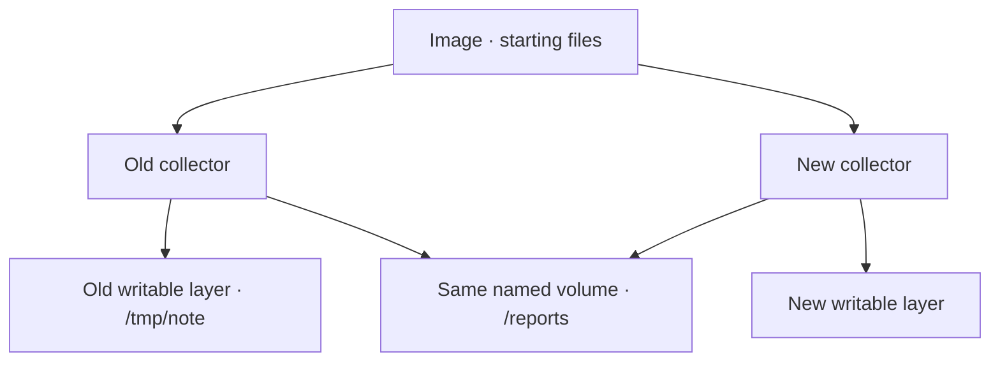

# Follow the report through a replacement

Imagine the physical server you built in the optional paid [Data Center game](https://store.steampowered.com/app/4170200/). On a separate Linux practice host, one collector container replaces another. The following diagram models that Linux exercise.

**Predict.** A technician writes /tmp/note and /reports/handoff. Both are new files and only /reports is mounted. What can the replacement read? The old writable layer goes away when the old container is removed. The new container can read handoff if it mounts the same volume at /reports. Stopping and starting the same container ordinarily preserves its writable layer.

**Change one detail.** Attach the volume at /archive on the replacement. Where would the technician look for handoff now? The data is at /archive/handoff, while a collector configured for /reports would look elsewhere.

[Try the real-engine lab](../labs/container-volume.md) · [Docker's illustrated storage guide](https://docs.docker.com/learn/content/keep-data-with-volumes-and-bind-mounts/)
