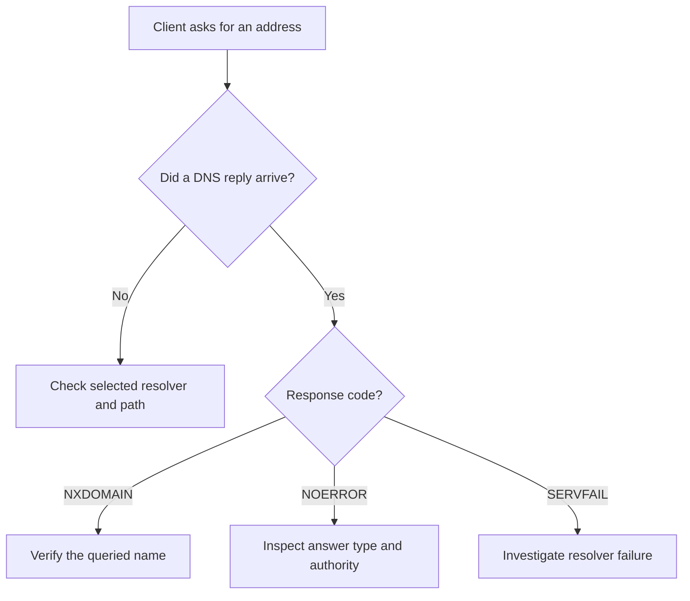

# Why did the lookup return no address?

Read the code before counting answers. An empty answer with NOERROR can have several meanings. In [ticket B](../fixtures/dns-shift/rack-b.txt) the existing A record, exact AAAA question, authority evidence, and absence of a referral or alias support a missing AAAA record. In [ticket D](../fixtures/dns-shift/rack-d.txt) there is no response code to interpret.

If you play the paid [Data Center game](https://store.steampowered.com/app/4170200/), trace the physical path between a server and its switch. Then use this separate diagram to explain what a connected cable can establish and which facts require a DNS reply. The paper exercise contains all the evidence.
