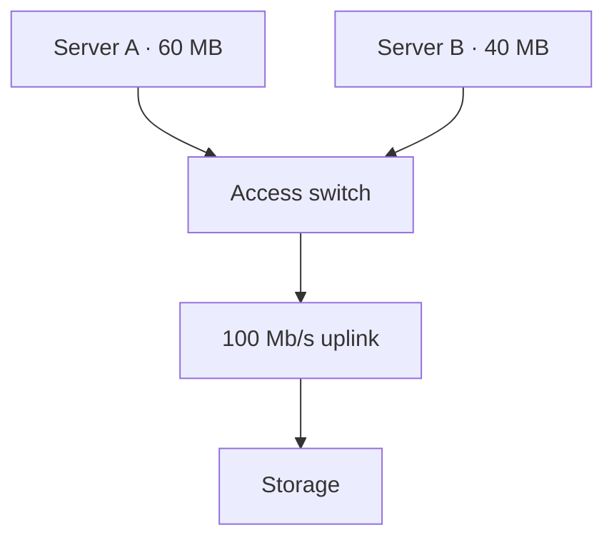

# Find the busy uplink

A fictional rack has two application servers sharing one uplink. During a 10-second observation, A sends 60 MB and B sends 40 MB toward storage. The uplink carries 100 Mb/s. For this exercise use decimal units, ignore overhead, and assume no other traffic.



**Predict before running the calculation.** Could the uplink carry the combined average? Would adding another server increase this link's capacity? If you own the paid [Data Center game](https://store.steampowered.com/app/4170200/), trace two server cables until their paths converge. The numbers in this ticket are a separate practice dataset. The diagram is enough to finish.

```bash
awk 'BEGIN { mb = 60 + 40; seconds = 10; rate = mb * 8 / seconds; printf "%.0f Mb/s, %.0f%% of uplink\n", rate, 100 * rate / 100 }'
```

The average is 80 Mb/s, or 80% of the uplink. Individual bursts could still queue. Try a five-second interval with the same byte total. Demand becomes 160 Mb/s, which exceeds the stated capacity. In a ticket, report the interval and both units. A moving packet animation alone cannot supply that measurement.

[Measure counter changes](../labs/counter-delta.md)

[Table of contents](../README.md)
