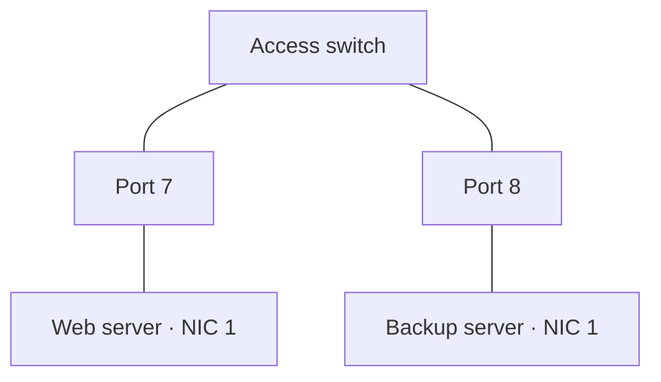

# Which port would you inspect?

A shift note says “rack A lost its link.” There are two servers in the rack. Before touching a cable, work out which endpoints belong in the ticket.

**Pick your workspace.** Use the diagram for free, build a comparable rack in the paid [Data Center](https://store.steampowered.com/app/4170200/) game, or trace a cable during a technician scenario in the paid [Data Center Simulator](https://store.steampowered.com/app/4535710/). The Steam listing for the latter also offers a demo. The diagram supplies all the evidence needed for this exercise.

**Ticket evidence.** In this fictional case, the backup server reports carrier and completes its local backup. The web server's Ethernet interface is administratively enabled but reports NO-CARRIER. A teammate on site confirms that port 7's link light is off.

1. Trace the web server's path with your finger. Name both endpoints and identify the cable you would leave alone.
2. Decide what you would check at each end before replacing hardware.
3. After the cable is reseated, the web server reports LOWER_UP. What can you close out, and what still needs a test?

Compare your handoff

Inspect the web server's NIC 1 and switch port 7. Check the seating and port status at both ends. Port 8 serves the backup server. LOWER_UP supports recovery of the local link. A service check from an intended client is still needed before reporting that the web application is available.

**Try the Linux side.** On an Ubuntu VM, run `ip -brief link` and `ip route show default`. Record the interface named after `dev`, if present. The VM has its own topology. Its output cannot identify the numbered port in the game. For a portfolio, put the labeled diagram and the Linux observation side by side and say which environment produced each one.

[Linux interface walkthrough](../chapters/05-interfaces.md) · [Contents](../README.md)

## Compare a link fault with a busy link

A second ticket reports that both servers remain connected but backups slow down when they run together. Which observation from the first ticket would still be useful? Confirming carrier establishes a starting point. To investigate shared capacity, follow both paths to their first shared link and [calculate average demand](rack-capacity.md).

## Trace a storage ticket on the same rack

The cable ticket established which server you were looking at. A new report says its backups are filling the root filesystem even though the archive disk has room. Sketch the expected path from server to disk, partition, and mount before suggesting a new drive. Then check your reasoning against the [two-disk map](storage-map.md).

## Verify the workload after the link returns

A link light comes back on at 14:08. The monitoring application still shows a 13:56 sample. Before declaring recovery, identify the expected sampling interval and the host that produces the sample. Use the [service decision diagram](service-state.md) to decide where to look next.

## Follow the workload inside one server

After the physical link recovers, a server can still run a replacement container against the wrong storage. Label the rack endpoint, then follow the [collector storage diagram](container-layers.md). Point to the component that must survive replacement for yesterday's handoff to remain readable.
