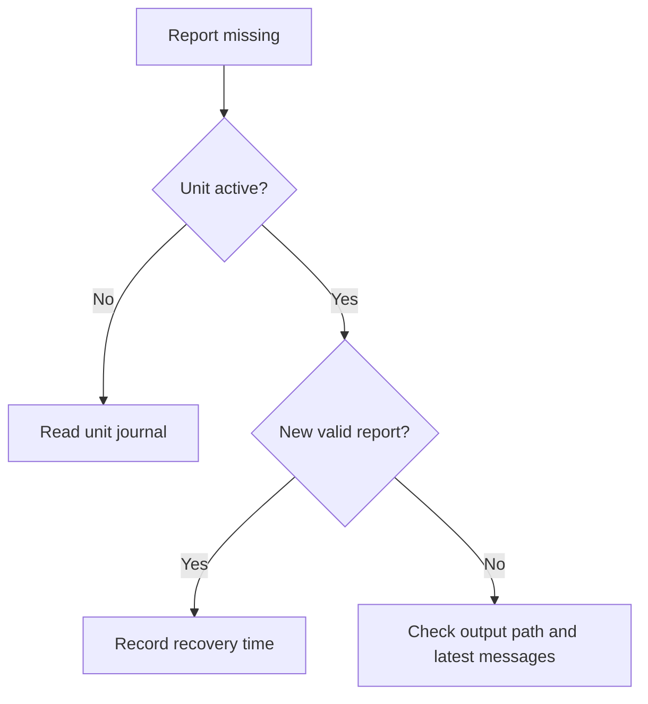

# Choose the next service check

A green light on a rack answers a hardware question. A systemd state answers a process-management question. Which one addresses the ticket about a missing report?

For this long-running monitor, follow the diagram once with active and a stale report, then again with failed and no report. For a short one-shot job, inspect its last exit result and output. A successful one-shot can finish and return to inactive.

Optional game pairing: choose a technician ticket in the paid [Data Center Simulator](https://store.steampowered.com/app/4535710/). Record what you could observe at the rack. Then use a separate simulated Linux case to document what you could verify about the application. [Play the quiet monitor](../games/service-output.md).
