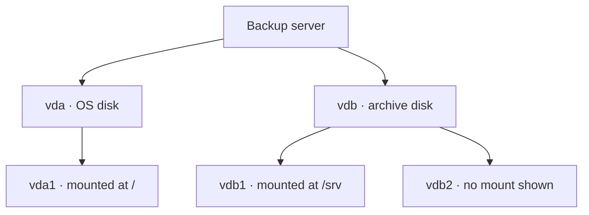

# Follow a report from a rack to a mount

Start with any server in the optional paid [Data Center game](https://store.steampowered.com/app/4170200/), or use the fictional server below. The game supplies a visual rack. The Linux storage layout below is a separate example.

**Find the destination.** A job writes to /srv/reports. Which partition receives the write if this map is complete? Now suppose /srv is unmounted but the directory still exists. Which filesystem would receive a new file there?

Trace both paths

With /srv mounted, vdb1 receives the file. Without the mount, path lookup stays on the root filesystem, vda1 in this example. The directory name can stay the same while the storage destination changes. An empty mount column for vdb2 gives you no evidence that the partition is unused or safe to erase.

For a second visual, open the [GParted manual](https://gparted.org/display-doc.php?name=help-manual) and locate its main window illustration. Identify the selected device and the partition rows. The illustration is enough for this exercise. Compare it with the mount lookup in the [destination lab](../labs/mount-destination.md).
